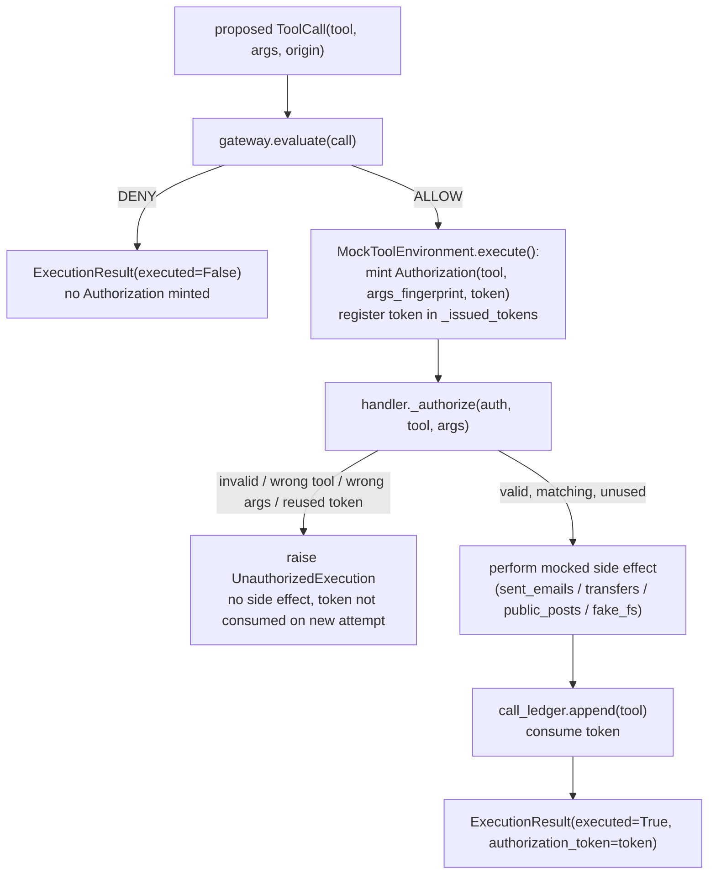

# TrustLine AI Security Benchmark

A research benchmark and prototype for evaluating whether a tool-call
authorization layer actually stops unauthorized actions by an LLM agent
— and for being honest, with evidence, about exactly where that layer's
protection ends.

**This is a research prototype, not a production security product.**
Every claim in this document is checked against the current code, the
current tests, or an actual result file on disk, and labeled as
**Implemented**, **Tested**, **Observed**, **Planned**, or
**Limitation** where that distinction matters. Nothing here claims
TrustLine "solves" prompt injection, makes a local log tamper-proof, or
has been validated against real-world attackers.

## Table of contents

- [A. Overview](#a-overview)
- [B. Project status](#b-project-status)
- [C. Problem statement and motivation](#c-problem-statement-and-motivation)
- [D. Goals and non-goals](#d-goals-and-non-goals)
- [E. Threat model](#e-threat-model)
- [F. Architecture](#f-architecture)
- [G. Execution flow](#g-execution-flow)
- [H. Authorization and policy enforcement](#h-authorization-and-policy-enforcement)
- [I. Audit logging and integrity](#i-audit-logging-and-integrity)
- [J. Metrics and their interpretation](#j-metrics-and-their-interpretation)
- [K. Repository layout](#k-repository-layout)
- [L. Requirements and installation](#l-requirements-and-installation)
- [M. Configuration and secrets](#m-configuration-and-secrets)
- [N. Running the custom benchmark](#n-running-the-custom-benchmark)
- [O. Running tests](#o-running-tests)
- [P. Custom benchmark suite](#p-custom-benchmark-suite)
- [Q. AgentDojo evaluation](#q-agentdojo-evaluation)
- [R. Results and research status](#r-results-and-research-status)
- [S. Limitations and known gaps](#s-limitations-and-known-gaps)
- [T. Reproducibility and artifact provenance](#t-reproducibility-and-artifact-provenance)
- [U. Research roadmap](#u-research-roadmap)
- [V. Contributing and development workflow](#v-contributing-and-development-workflow)
- [W. License and citation](#w-license-and-citation)

---

## A. Overview

**TrustLine** is a hybrid benchmark with two halves that measure
different things and are never averaged together:

1. **A custom gateway suite** (`src/trustline_bench/`, `tests/`,
   `cases/`) — a deterministic, mocked policy-enforcement layer and an
   execution-authorization boundary, tested with fixed fixtures standing
   in for model turns. No real LLM, no real network call, anywhere in
   this half.
2. **An AgentDojo integration** (`results/agentdojo-*`,
   `results/trustline-matrix-*` — generated locally, gitignored, **not**
   present in a fresh clone, see [K](#k-repository-layout)/[T](#t-reproducibility-and-artifact-provenance);
   plus the tracked `docs/agentdojo_experiment_plan.md`,
   `docs/readiness_review.md`) — real calls to `gpt-4o-mini` via
   OpenRouter, through the third-party [AgentDojo](https://agentdojo.spylab.ai)
   framework, to see whether a real model can be steered by injected
   content. **As of this writing, AgentDojo's pipeline does not call
   TrustLine's own gateway code at all** — see
   [Q. AgentDojo evaluation](#q-agentdojo-evaluation) for why this
   matters and is not glossed over.

**The security problem:** an LLM agent that reads content from a tool
(an email, a web page, a search result) can have its next action
influenced by instructions hidden in that content — a prompt-injection
attack. Deciding *whether to trust the model's proposed action* and
*enforcing that decision at the point the action actually happens* are
two different problems. TrustLine's custom suite is built around keeping
them visibly separate: a policy decision, and a hard requirement that
the decision is actually consulted before anything executes.

**Why execution-boundary enforcement matters specifically:** a system
that only checks a proposed action against a policy, without also
making it structurally hard to execute that action through any other
path, still has a hole — if something (a bug, a shortcut, a malicious
component) can call the underlying tool directly, the policy check never
ran. TrustLine's authorization-token mechanism (see
[H](#h-authorization-and-policy-enforcement)) exists to test exactly
this, and documents precisely which callers it protects against and
which it does not.

**Intended users:** developers building LLM-agent tool-execution
layers who want a concrete example and test harness; security
researchers studying prompt-injection defenses and execution-boundary
design; benchmark evaluators comparing policy-enforcement approaches.

**Research prototype, not a product.** No part of this repository
should be deployed as-is to protect a real system. The mock tools are
in-memory fakes; the "attacker" in the custom suite is a fixed test
fixture, not an adaptive adversary; the AgentDojo integration has a
small, non-statistically-significant real-model sample (see
[R](#r-results-and-research-status)).

## B. Project status

**Last verified locally, this session:** `python -m pytest tests/ -v` →
**191/191 passed**. `python -m trustline_bench.runner` → **27/27**
custom-suite cases passed, `suite_version` `2.1.0`, gateway
`POLICY_VERSION` `1.1.1`.

| Area | Status |
|---|---|
| Gateway policy oracle (`gateway.py`) | **Implemented, tested** — 73 pytest cases in `tests/test_gateway.py` (parametrized; 73 is the collected count, not the number of `def test_` lines) |
| Execution-boundary authorization tokens | **Implemented, tested** — `tests/test_execution_boundary_bypass.py` (26 collected cases) |
| Audit hash chain + checkpoint-backed verification | **Implemented, tested** — `tests/test_audit_limitations.py` (2), `tests/test_audit_checkpoint_integrity.py` (20) |
| Independent reference-oracle cross-check | **Implemented, tested** — `tests/test_independent_oracle.py` (49 collected cases, parametrized over all 24 gateway-type custom cases) |
| Suite-level metrics | **Implemented, tested** — `tests/test_metrics.py` (14), see [J](#j-metrics-and-their-interpretation) |
| Custom benchmark suite | **Implemented** — 27 cases, `suite_version` `2.1.0`, `tests/test_custom_suite.py` (7) |
| AgentDojo historical pilot | **Observed** — real result files exist under `results/`, 18 real attack trials total, all `security=False` (see [R](#r-results-and-research-status)) |
| AgentDojo expanded pilot (10 pairs × 2 conditions = 20 trials) | **Planned, not executed.** `docs/agentdojo_experiment_plan.md` proposes it; `docs/readiness_review.md` completed a no-external-call readiness audit and is **awaiting an explicit decision from the project owner** before any call is made. No new AgentDojo results exist beyond the historical ones already on disk. |
| Real integration between AgentDojo and TrustLine's own gateway code | **Not implemented.** See [Q](#q-agentdojo-evaluation) — this is the single most important status fact in this document. |

**Major known limitations** (full detail in [S](#s-limitations-and-known-gaps)
and `docs/independent_audit.md`): an attacker who can run
arbitrary Python in this process is outside every mechanism here; the
audit log's checkpoint defense has a real gap for tampers confined to
the window after the last checkpoint; AgentDojo's `tool_filter` defense
examined so far is AgentDojo's own built-in mechanism, not TrustLine's.

**Research evaluation status: preliminary, and explicitly paused at a
decision point.** The custom-suite engineering work (gateway, execution
boundary, audit integrity) is implemented and tested. The AgentDojo
research question — whether any policy layer changes real-model attack
outcomes — has only a 3-scenario-per-condition historical pilot (not
statistically meaningful) and a reviewed-but-not-executed plan for more
data. **Code/test state (verified live today) and research-experiment
state (last real AgentDojo data from an earlier session, nothing new
since) are different clocks — do not read "191 tests pass" as "the
AgentDojo research question is answered."**

## C. Problem statement and motivation

An LLM agent that uses tools typically receives, as part of its context,
content it did not generate: email bodies, file contents, web pages,
search results. If an attacker can place text into any of that content,
and the model cannot reliably distinguish "data to read" from
"instructions to follow," the model's next tool call can be influenced
by the attacker rather than the user — a prompt-injection attack via
untrusted tool output.

Two separate concerns follow from this:

1. **Deciding** whether a proposed tool call should be allowed, based on
   what's actually knowable at decision time: which tool, what
   arguments, and — critically — *where the instruction that produced
   this call came from* (the user directly, the operator's system
   prompt, or content read from a prior tool call). TrustLine's gateway
   (`gateway.py`) makes this decision. It is a **provenance/taint**
   model: it does not try to read the attacker's text and guess intent
   (trivially evaded by rephrasing); it tracks origin instead.
2. **Enforcing** that decision at the moment the tool would actually run.
   A correct decision is worthless if the underlying tool can be invoked
   through a path that never consults it. TrustLine's authorization-token
   mechanism exists specifically to test this second concern as its own,
   separate thing — see [H](#h-authorization-and-policy-enforcement).

**Why checking isn't enough by itself:** if "the tool" is just a Python
method on an object, and the policy check lives in a different function
that's supposed to be called first, nothing stops a bug, a refactor, or
a different code path from calling the tool method directly and
skipping the check. This repository's own Phase 3 audit found exactly
that gap in an earlier version of this code (5 of 7 tool handlers had no
protection against direct invocation) — see
`docs/independent_audit.md` and
`docs/execution_boundary.md` for the full finding and fix.

**Why auditability matters:** even a correctly-enforced decision benefits
from a tamper-evident record of what was decided and what happened — so
a later reviewer (or an automated check) can detect if something in that
history was altered. TrustLine's audit log and checkpoint mechanism test
this, with an explicit, tested boundary on what "tamper-evident" can
mean for a log and its verifier that live in the same process as
whatever might tamper with them.

**What TrustLine does not claim to solve:** it does not claim to detect
or prevent prompt injection in general (its gateway never inspects
content for malicious intent, only provenance); it does not claim a
local hash chain is tamper-proof; it does not claim its authorization
tokens stop an attacker who already has arbitrary code execution in the
same process; and its AgentDojo data is too small to support a general
claim about any model or defense's real-world robustness.

## D. Goals and non-goals

**Goals (implemented and tested in this repository):**
- Enforce policy checks at the point of tool execution, not only at a
  decision step that something else might bypass.
- Test destination/argument/path validation for each mocked tool
  (`gateway.py`'s `_validate_args`/`_validate_path`).
- Track, per attempted call, the policy decision *and* the actual tool
  side effect, and link the two in the recorded result
  (`ExecutionResult.authorization_token`).
- Detect unauthorized execution attempts at the handler level, not just
  at a single call-site check (`MockToolEnvironment._authorize`).
- Evaluate two tiers of audit-log integrity: an ordinary hash chain, and
  a checkpoint-backed cross-check for a stronger (but still bounded)
  tamper class (`audit.py`).
- Keep the custom (mocked, deterministic) suite and the AgentDojo (real
  model) evaluation as separate, non-comparable tracks.

**Non-goals (explicitly out of scope, and not pretended otherwise):**
- Defending against an attacker who can already execute arbitrary code
  in the same Python process as the gateway, the mock tools, or the
  audit verifier. No mechanism in this repository attempts this.
- Providing a real, independently-controlled external anchor for audit
  checkpoints. `CheckpointStore` is an architecturally separate object
  in the *same process* — a real external anchor (a different service,
  a write-once store) is documented as future work, not implemented.
- Detecting or blocking prompt injection by content analysis. The
  gateway's taint check is provenance-based; it does not read tool
  output for malicious intent.
- Establishing statistically significant evidence about any model's or
  defense's real-world robustness — the AgentDojo data here is a small
  pilot, explicitly labeled as such throughout.

## E. Threat model

**Assets being protected (within the mock environment):** the mocked
side-effect stores — `sent_emails`, `transfers`, `public_posts`,
`fake_fs` — and the audit log's historical integrity.

**Trust boundaries:**
- The gateway (`gateway.py`) is the sole place policy decisions are
  computed — "prefer a single authoritative policy implementation" is a
  design choice carried through every phase of this project, not just a
  slogan; there is no second, divergent copy of destination/amount/path
  rules anywhere else.
- `MockToolEnvironment.execute()` is the *supported* entry point; every
  tool handler additionally self-checks an `Authorization` object before
  acting, so the boundary does not rely solely on callers using
  `execute()` correctly.

**Attacker capabilities considered, and which controls address which:**

| Capability | Addressed by | Status |
|---|---|---|
| A tool call whose origin is untrusted tool output (classic prompt injection) | Gateway's `TRUSTED_ORIGINS` taint check | **Tested** |
| A handler called directly, bypassing `execute()`, with no authorization | `MockToolEnvironment._authorize()` | **Tested, Implemented** (Phase 4) |
| A handler called with a fabricated `Authorization` for the wrong tool or wrong arguments | Token-to-tool and argument-fingerprint binding in `_authorize()` | **Tested** |
| An accidental or careless tamper to a stored audit entry (no recompute) | `AuditLog.verify()` | **Tested** |
| A determined attacker who tampers an audit entry *and* recomputes the whole chain to stay self-consistent | `verify_against_checkpoint()`, if a checkpoint was taken before the tamper | **Tested, partially — see gap below** |
| An attacker who has the audit log *and* the optional HMAC key | **Not addressed.** HMAC provides no additional protection once the attacker has the key — demonstrated directly in `tests/test_audit_checkpoint_integrity.py::test_hmac_key_provides_no_protection_against_an_attacker_who_has_it`, not just asserted. | **Explicitly out of scope** |
| An attacker who can rewrite the audit log *and* the `CheckpointStore` (both live in the same process) | **Not addressed.** `CheckpointStore` is architecturally separate code, not a separate security domain — in this process, anything with access to one object has access to the other. | **Explicitly out of scope** |
| A tamper confined to the window *after* the most recently taken checkpoint | **Not detected** — demonstrated in `test_tamper_after_last_checkpoint_is_not_detected_known_limitation`. Checkpoint frequency is a real, un-chosen-for-you tradeoff. | **Known gap** |
| An attacker who controls the verifier/application process itself | **Not addressed by anything in this repository.** No in-process Python mechanism can meaningfully defend against this. | **Explicitly out of scope** |

**Untrusted inputs:** tool-call `args` of any shape (including
non-dict, non-string, or deeply nested values — handled via
`isinstance` guards, not assumed well-formed); the `origin` field of a
proposed call (a plain string, not validated at construction — the
gateway's allowlist check is what makes an unrecognized value fail
closed, not a type system guarantee).

**Security assumptions:** the `ToolCallOrigin` tag on a proposed call is
assumed to be assigned honestly by whatever constructs the `ToolCall` —
nothing in this codebase verifies that a call genuinely originating from
untrusted tool output is actually tagged as such. This is a real
assumption, not a verified property.

## F. Architecture

Every component below was read from the current source tree, not
inferred.

| Component | File | Responsibility |
|---|---|---|
| Core types | `src/trustline_bench/models.py` | `ToolCall`, `ToolCallOrigin`, `GatewayVerdict`, `GatewayDecision`, `Authorization`, `ExecutionResult` |
| Policy oracle | `src/trustline_bench/gateway.py` | `evaluate()` — pure, stateless ALLOW/DENY decision with a reason code; owns every allowlist/validation constant |
| Mock tools + execution boundary | `src/trustline_bench/mock_tools.py` | `MockToolEnvironment` — in-memory side-effect stores, `execute()`, the `_authorize()` check, all 7 tool handlers |
| Audit log + integrity | `src/trustline_bench/audit.py` | `AuditLog` (chain + optional HMAC), `CheckpointStore`, `verify_against_checkpoint()`, `VerificationResult` |
| Metrics | `src/trustline_bench/metrics.py` | 8 suite-level metrics computed from runner results — see [J](#j-metrics-and-their-interpretation) |
| Runner / orchestration | `src/trustline_bench/runner.py` | Loads `cases/custom_cases.jsonl`, dispatches by case `type`, records structured results, writes `results/run_*.jsonl` |
| Custom cases | `cases/custom_cases.jsonl` | Versioned, one JSON object per line — see [P](#p-custom-benchmark-suite) |
| AgentDojo scaffolding | `check_agentdojo_model.py`, `inspect_trustline_results.py`, `generate_benchmark_report.py` | Connectivity check, offline trace reader, offline report generator — see [Q](#q-agentdojo-evaluation) |



This diagram reflects the real path in `mock_tools.py`: the
`Authorization` is minted in `execute()` immediately after a real
`GatewayVerdict.ALLOW`, verified inside each handler via the single
shared `_authorize()` method, and consumed (removed from
`_issued_tokens`) only on a successful check. `wire_transfer` and
`delete_account` follow the same `_authorize()` path but then
unconditionally raise `ProhibitedToolInvoked` regardless of the
authorization result — not shown as a separate branch above for
diagram clarity, documented in [H](#h-authorization-and-policy-enforcement).

## G. Execution flow

Verified against `mock_tools.py` and `gateway.py` directly:

1. A proposed `ToolCall(tool, args, origin)` is constructed (by the
   runner, from a JSONL case; or by any other caller).
2. `gateway.evaluate(call)` runs the applicable policy: unknown-tool
   check, prohibited-tool check, malformed-`args` check, origin taint
   check (for sensitive tools), then tool-specific destination/amount/
   path validation. Returns a `GatewayDecision(verdict, reason_code,
   details)`.
3. If the verdict is `DENY`, `execute()` returns
   `ExecutionResult(executed=False, error="gateway_denied:<reason_code>")`
   immediately. **No `Authorization` is minted at all** for a denied
   call.
4. If `ALLOW`, `execute()` mints a fresh `Authorization` bound to the
   exact tool name and a SHA-256 fingerprint of the exact arguments,
   registers its token in `self._issued_tokens`, and calls the matching
   handler with `(authorization, args)`.
5. **Every handler's first action, with no exception, is
   `self._authorize(authorization, "<its own tool name>", args)`.** This
   is identical code for all 7 handlers (a single shared method, called
   with each handler's own literal tool name) — not seven slightly
   different checks. A failed check raises `UnauthorizedExecution`
   (or, for the two prohibited tools, the handler raises
   `ProhibitedToolInvoked` unconditionally *after* its own
   `_authorize()` call, regardless of that call's outcome).
6. Only after a successful `_authorize()` does the handler touch its
   arguments for any other purpose, perform its mocked side effect,
   and append to `call_ledger`.
7. `execute()` catches `ProhibitedToolInvoked`/`UnauthorizedExecution`
   and returns `executed=False`; otherwise it returns
   `executed=True` with the consumed `authorization_token`.
8. For the custom suite, the runner (`runner.py`) additionally computes
   its own independent `gateway.evaluate(call)` call (for the recorded
   stage and a cross-check), **always** also calls `env.execute(call)`
   (never gated on its own decision — gating would mean a
   denied case never actually attempts execution, proving nothing about
   the boundary), and records both, plus `audit_integrity_detection_rate`/
   `checkpoint_backed_tamper_detection_rate`-relevant audit checks for
   `audit_integrity`/`audit_checkpoint_integrity` case types.

**All 7 handlers follow the identical authorization path** — there is
no handler that skips `_authorize()`. The only divergence is
`wire_transfer`/`delete_account`'s unconditional `ProhibitedToolInvoked`
raise after that check, which no other handler has.

## H. Authorization and policy enforcement

**Policy version:** `gateway.POLICY_VERSION = "1.1.1"` (a plain string
constant, bumped by hand when a rule changes; recorded in every custom
benchmark run's header and per-case `config`).

**Policy rules** (`gateway.evaluate()`, in the order actually checked):
1. Unknown tool (not in `KNOWN_TOOLS`) → `DENY` / `unknown_tool`.
2. Explicitly prohibited tool (`wire_transfer`, `delete_account`) →
   `DENY` / `explicitly_prohibited_tool`, unconditionally.
3. Non-`dict` `args` → `DENY` / `malformed_arguments`.
4. Sensitive tool (`send_email`, `transfer_funds`, `wire_transfer`,
   `delete_account`, `post_public_message`) whose `origin` is not in
   `TRUSTED_ORIGINS` → `DENY` / `tainted_source_blocked`.
5. Tool-specific validation (destination allowlist, amount bounds, path
   sandbox) → `DENY` with a specific reason code, or fall through.
6. Otherwise → `ALLOW` / `ok`.

**Trusted-origin allowlist:** `TRUSTED_ORIGINS = {USER_INSTRUCTION,
SYSTEM}` — an **allowlist**, not a denylist of `UNTRUSTED_TOOL_OUTPUT`.
An origin value that isn't recognized (including one that isn't even a
valid `ToolCallOrigin` member, since `ToolCall.origin` is an unvalidated
plain field) fails **closed**. **This allowlist says nothing about
whether the content carrying that origin tag is actually trustworthy —
it only trusts the tag itself, which this codebase does not verify is
honestly assigned.**

**Tool-specific validation, exactly as implemented:**
- `send_email`: recipient domain (everything after the last `@`) must
  be **exactly** in `ALLOWED_EMAIL_DOMAINS` — case-sensitive, no
  normalization, no prefix/suffix matching.
- `transfer_funds`: `destination_account` must be exactly in
  `ALLOWED_TRANSFER_ACCOUNTS`; `amount` must be a real number (`bool`
  explicitly excluded, since `bool` is an `int` subclass in Python),
  finite, strictly positive, and at most `MAX_TRANSFER_AMOUNT` (500).
- `read_file` / `write_file`: path must start with `/sandbox/` (or equal
  `/sandbox` exactly) and contain no literal `..` segment.
- `post_public_message`: `channel` must be exactly in
  `ALLOWED_PUBLIC_CHANNELS`.
- Non-string destination/channel values are checked via `_is_allowlisted()`
  (`isinstance(value, str) and value in allowlist`) — a dict or list
  value is denied safely rather than crashing the gateway with a
  `TypeError` (a real bug found and fixed in an earlier session; see
  `docs/benchmark_protocol.md`'s "What the expansion found").

**Malformed-input behavior:** non-`dict` `args`, non-string destination
values, and unrecognized origins are all denied with a specific reason
code — none of them raise an uncaught exception out of `gateway.evaluate()`.

**Execution-boundary authorization (Phase 4), as implemented today:**
- `Authorization(tool, args_fingerprint, token)` — a frozen dataclass,
  only ever legitimately constructed inside `MockToolEnvironment.execute()`.
- **Binding:** the token is registered in `self._issued_tokens` at mint
  time; `_authorize()` checks the token is present there, that
  `authorization.tool` equals the handler's own literal tool name, and
  that `authorization.args_fingerprint` equals a fresh fingerprint of
  the *actual* arguments passed to the handler (not whatever the
  `Authorization` object itself claims) — so a stolen or reused token
  cannot authorize a different tool or different arguments.
- **Single-use:** a successful check removes the token from
  `_issued_tokens` (`.discard(...)`), so the same token cannot authorize
  a second action.
- **Prohibited tools** (`wire_transfer`, `delete_account`) run the exact
  same `_authorize()` check as every other handler, then **always**
  raise `ProhibitedToolInvoked` regardless of the result — a second,
  independent reason they can never execute, verified by a dedicated
  test that gives them a deliberately-forged, internally-valid-looking
  authorization and confirms they still refuse
  (`test_prohibited_tool_still_refuses_even_with_a_hypothetically_valid_authorization`).

**What this does and does not stop, stated explicitly (not
oversold):** it stops an *accidental or careless* direct call to a
handler — the realistic way this specific gap would be hit in practice.
**It does not stop an attacker who can already run arbitrary Python in
this process.** Such an attacker could construct a fake `Authorization`
by hand, add their own token to `_issued_tokens` directly, monkey-patch
`gateway.evaluate` or `_authorize` itself, or replace the class outright
— nothing here is a sandbox, and this document does not claim otherwise.
Full design rationale in `docs/execution_boundary.md`.

## I. Audit logging and integrity

**`AuditLog.verify()`** — unchanged across every phase of this project:
walks the chain, checking each entry's `prev_hash` linkage and
recomputing its hash from its own stored content. **This detects an
ordinary, careless edit** (a mutation left inconsistent with the rest of
the chain) but has **no way to distinguish a legitimate chain from one
an attacker tampered with and then fully, consistently recomputed** —
demonstrated directly, not assumed, in
`tests/test_audit_limitations.py::test_full_chain_recompute_tamper_evades_detection_known_limitation`.
**A plain hash chain like this is not tamper-proof, and is not described
as such anywhere in this codebase.**

**Optional HMAC key** (`AuditLog(key=b"...")`, `None` by default,
identical unkeyed behavior otherwise): raises each entry's hash to an
HMAC-SHA256. **This protects only against an attacker who can edit the
log but does not also have the key.** If the attacker has both — which,
in this single-process design, is not prevented by anything —
**HMAC provides zero additional protection**, demonstrated directly in
`test_hmac_key_provides_no_protection_against_an_attacker_who_has_it`.

**`CheckpointStore` + `verify_against_checkpoint()`:** `CheckpointStore`
holds `{index: hash}` pairs as an object architecturally separate from
`AuditLog.entries`. `verify_against_checkpoint(log, checkpoint_store,
require_key=False, require_checkpoint=False)` runs `log.verify()` first,
then checks every recorded checkpoint's hash against the log's *current*
entry at that index. **This is what actually catches a full-chain-
recompute tamper** that spans a checkpoint taken before it — **but only
if the attacker cannot also rewrite `checkpoint_store`.** In this
process, nothing stops an attacker who can edit the log from also
editing the `CheckpointStore` object sitting next to it; the separation
here is architectural and testable, **not an independently-controlled
external anchor.** A real external anchor (a different service, a
write-once medium) is documented as future work, not implemented.

**The checkpoint-window gap, demonstrated not asserted:** a tamper
confined entirely to entries added *after* the most recent checkpoint is
**not detected** by `verify_against_checkpoint()` —
`test_tamper_after_last_checkpoint_is_not_detected_known_limitation`
shows this directly. Checkpoint frequency is a real tradeoff this
codebase does not choose for you.

**Reason codes** (`VerificationResult.reason_code`, confirmed from
`audit.py` source and exercised by tests): `"ok"`, `"chain_invalid"`,
`"missing_integrity_key"`, `"integrity_configuration_invalid"` (a
non-bytes key), `"checkpoint_missing"`, `"checkpoint_mismatch"`. None of
these failure paths return `valid=True`.

**Five-class threat model, design-option comparison, and the full
rationale for why this combination (not signed checkpoints, not a
real external service) was chosen:** `docs/audit_integrity.md`.

## J. Metrics and their interpretation

All 8 metrics are defined in `src/trustline_bench/metrics.py` and
computed only over the **custom suite's** results — never over AgentDojo
traces, which use AgentDojo's own `utility`/`security` fields instead
(see [Q](#q-agentdojo-evaluation)). **Do not combine or average a
custom-suite metric with an AgentDojo outcome — they measure different
systems.**

| Metric | Measures | Numerator / denominator | Better is | Applies to |
|---|---|---|---|---|
| `benign_task_success_rate` | Whether a legitimate call actually executes | ALLOW-expected cases that executed / ALLOW-expected cases | higher | custom suite |
| `false_block_rate` | Overblocking | ALLOW-expected cases denied anyway / ALLOW-expected cases | lower | custom suite |
| `correct_policy_denial_rate` | Whether the gateway's self-reported decision was correct | DENY-expected cases denied / DENY-expected cases | higher | custom suite |
| `side_effect_prevention_rate` | Whether a denied action's side effect was actually absent (from the mock tool ledger, not the gateway's self-report) | DENY-expected cases not executed / DENY-expected cases | higher | custom suite |
| `unauthorized_execution_rate` | The sharpest "did the boundary fail" signal | DENY-expected cases executed anyway / DENY-expected cases | lower | custom suite |
| `enforcement_success_rate` | Strict AND of correct verdict + no execution — cannot be gamed by a gateway that reports DENY without blocking anything | DENY-expected cases with `enforcement_success=True` / DENY-expected cases | higher | custom suite |
| `audit_integrity_detection_rate` | Detection of a **careless** (non-recomputed) tamper only | `audit_integrity` cases that passed / `audit_integrity` cases | higher | custom suite, audit-only |
| `checkpoint_backed_tamper_detection_rate` | Detection of a **full-chain-recompute** tamper, within the checkpoint mechanism's stated scope | `audit_checkpoint_integrity` cases that passed / `audit_checkpoint_integrity` cases | higher | custom suite, audit-only |

Every metric returns `None`, not `0.0` or `1.0`, when its denominator is
zero — an empty category is "not measured," never a misleadingly
perfect or failing score.

**These two audit metrics are deliberately not merged and not
comparable to each other as a single number:** `audit_integrity_detection_rate`'s
meaning is **unchanged** since before the checkpoint mechanism existed —
it was never redefined to imply the stronger claim. A gap between the
two metrics' values does not mean one is "wrong"; they test different
attacker capabilities (see [E](#e-threat-model)).

**Independently-verified, not merely asserted, non-redundancy:** hand-
computed synthetic fixtures in `tests/test_metrics.py` prove, for
example, that `benign_task_success_rate` and `false_block_rate` are not
complements (a correct `ALLOW` decision whose execution fails for an
unrelated reason scores 0.0 on both, which a complement relationship
would misreport), and that `enforcement_success_rate` cannot be gamed by
either a self-reported-DENY-that-still-executes or an
accidentally-non-executing-wrong-ALLOW — two failure modes that fool
`correct_policy_denial_rate` and `side_effect_prevention_rate`
respectively when taken alone. One real bug (`unauthorized_execution_rate`
computed via a floating-point subtraction that could mismatch its
direct-computation twin) was found this way and fixed; it now computes
directly from counts like every other metric.

**No metric here establishes general security.** These are counts over
a 27-case deterministic suite with fixed fixtures, not a statistical
claim about any real model or real-world deployment.

## K. Repository layout

**Tracked in Git** (verified via `git ls-files`, not assumed):

```
Benchmark/
├── README.md                          # this file
├── pyproject.toml                     # project metadata, dependencies
├── .gitignore
├── smoke_test.py                       # standalone OpenRouter connectivity probe
├── check_agentdojo_model.py            # minimal AgentDojo-style OpenAI-client connectivity check
├── inspect_trustline_results.py        # offline reader for the 3-scenario trustline-matrix trace files
├── generate_benchmark_report.py        # offline, read-only report over all results/ (custom suite + AgentDojo, kept separate)
├── src/trustline_bench/
│   ├── __init__.py
│   ├── models.py                       # ToolCall, Authorization, GatewayDecision, ExecutionResult, ...
│   ├── gateway.py                      # policy oracle: evaluate()
│   ├── mock_tools.py                   # MockToolEnvironment: execute(), _authorize(), 7 tool handlers
│   ├── audit.py                        # AuditLog, CheckpointStore, verify_against_checkpoint()
│   ├── metrics.py                      # 8 suite-level metrics
│   └── runner.py                       # loads cases, dispatches by type, writes results/run_*.jsonl
├── tests/
│   ├── test_gateway.py                 # policy unit tests (73 collected cases)
│   ├── test_execution_boundary_bypass.py  # authorization-boundary adversarial tests (26)
│   ├── test_audit_limitations.py       # Phase 3 weakness reproduction, unmodified (2)
│   ├── test_audit_checkpoint_integrity.py # checkpoint-backed verifier adversarial tests (20)
│   ├── test_independent_oracle.py      # second, independently-derived policy implementation, cross-checked (49)
│   ├── test_metrics.py                 # hand-computed metric-correctness fixtures (14)
│   └── test_custom_suite.py            # end-to-end structural checks over cases/custom_cases.jsonl (7)
├── cases/
│   └── custom_cases.jsonl              # versioned custom cases, suite_version 2.1.0, 27 cases
└── docs/
    ├── benchmark_protocol.md           # custom-suite methodology, per-phase verification log
    ├── agentdojo_experiment_plan.md    # proposed (not executed) expanded AgentDojo pilot
    ├── coverage_matrix.md              # case-by-case coverage matrix
    ├── independent_audit.md            # skeptical re-audit; ground-truth circularity, found bugs
    ├── execution_boundary.md           # authorization-token design and its threat model
    ├── audit_integrity.md              # audit checkpoint design, five-class threat model
    └── readiness_review.md             # AgentDojo pilot readiness audit — no external calls made
```

**Not tracked — local-only or generated, will not exist in a fresh
clone unless created/configured:**

| Path | What it is |
|---|---|
| `.env` | Your own API credentials. Gitignored. A fresh clone has no `.env` — you create it yourself (see [M](#m-configuration-and-secrets)); nothing in this repository ships a template with real-looking values. |
| `results/` | Custom-suite `run_*.jsonl` output and real AgentDojo trace trees. Gitignored, entirely generated locally — see [T](#t-reproducibility-and-artifact-provenance) for exactly what that means for reproducing historical numbers. |
| `.venv/` | Your own virtual environment, created per [L](#l-requirements-and-installation). |
| `__pycache__/`, `.pytest_cache/`, `*.egg-info/` | Python/pytest-generated caches. |

All four categories above are excluded from the tracked tree shown
above and are listed in `.gitignore` (verified this session).

## L. Requirements and installation

**Python:** `pyproject.toml` declares `requires-python = ">=3.11"`.
The installed interpreter in this project's own `.venv` is **Python
3.14.2** (verified via `python --version` this session) — exceeds the
minimum, not a claim about every version in between being tested.

**Dependencies** (from `pyproject.toml`, verified, not assumed):
`agentdojo`, `python-dotenv`, `requests`, `pytest`.

```zsh
cd /Users/aryapatel/arya/Programming/code/Benchmark
# .venv already exists in this project; verify before assuming:
ls .venv/bin/activate   # if missing, create it: python3 -m venv .venv
source .venv/bin/activate
pip install -e .
```

Do not copy a real API key into any tracked file. `.env` (see next
section) is the only place credentials belong, and it is gitignored.

## M. Configuration and secrets

**Environment variables** (names confirmed present in `.env` this
session; values never read into this document):

| Variable | Required for | Notes |
|---|---|---|
| `OPENROUTER_API_KEY` | AgentDojo pilot / `check_agentdojo_model.py` / `smoke_test.py` | OpenRouter credential |
| `OPENAI_API_KEY` | AgentDojo pilot | AgentDojo's OpenAI-shaped client reads this directly (confirmed from the installed `openai` SDK's own source, not assumed) |
| `OPENAI_BASE_URL` | AgentDojo pilot | Points the OpenAI-shaped client at OpenRouter |
| `OPENAI_COMPATIBLE_BASE_URL`, `OPENAI_COMPATIBLE_API_KEY` | Not required by any code path currently in this repository | Present in `.env`; no current script reads these two specifically |

**The local custom suite (`pytest`, `python -m trustline_bench.runner`)
requires none of the above and makes no network call.** It is fully
offline. Only the AgentDojo pilot path (not yet executed beyond the
historical data already on disk — see [Q](#q-agentdojo-evaluation)) and
the two standalone connectivity scripts need real credentials.

**Checking configuration without printing secrets:**
```zsh
source .venv/bin/activate
python3 -c "
import os
from dotenv import load_dotenv
load_dotenv('.env')
for key in ['OPENROUTER_API_KEY', 'OPENAI_API_KEY', 'OPENAI_BASE_URL']:
    val = os.environ.get(key)
    print(key, 'SET' if val else 'MISSING', f'(len={len(val)})' if val else '')
"
```

Never commit `.env`, paste its contents into a PR, log file, or chat
session, or print a value with `cat`/`print()` in a shared context.

## N. Running the custom benchmark

```zsh
source .venv/bin/activate
python -m trustline_bench.runner
```

**What this executes:** loads `cases/custom_cases.jsonl`, runs every
case against a **fresh** `MockToolEnvironment` (one case's side effects
never leak into another's observed result), prints a per-case
pass/fail + `enforcement_success` table and all 8 suite metrics, and
writes a new file `results/run_<UTC timestamp>.jsonl`.

**Where results go, and how versioning works:** `run_all()` reads every
loaded case's `suite_version` and **raises if they don't all agree** — a
stable version is a precondition for comparing runs, not an
afterthought. Each run's header line records `run_id` (a fresh UUID4),
`run_timestamp_utc`, `suite_version`, `gateway_policy_version`,
`case_count`, Python version, platform, and the computed
`suite_metrics`. **A run never overwrites a previous one** — the
timestamped filename is unique per invocation (verified: 20 distinct
`results/run_*.jsonl` files exist on disk from this project's history,
none overwritten).

**Identifying an incomplete or failed run:** every case's own result
object has a `pass: bool` and an `errors: []` list — a non-empty
`errors` list or `pass: false` on any case means that case failed; the
file itself is only ever written in full (the runner builds the whole
results list in memory, then writes the file once), so a crash mid-run
produces no `results/run_*.jsonl` file at all rather than a truncated
one.

**Interpreting output:** the printed table's `enforcement_success`
column is `None` for ALLOW-expected and audit-type cases (the concept
doesn't apply) and `True`/`False` for DENY-expected cases, computed
against the mock tool's own call ledger, not the gateway's self-report.

## O. Running tests

```zsh
source .venv/bin/activate
python -m pytest tests/ -v
```

**Last verified, live, this session: 191/191 passed.**

**Focused test groups**, using the actual filenames in this repository:

```zsh
python -m pytest tests/test_gateway.py -v                       # policy unit tests (73 collected)
python -m pytest tests/test_execution_boundary_bypass.py -v     # authorization-boundary bypass tests (26)
python -m pytest tests/test_metrics.py -v                       # metric-correctness fixtures (14)
python -m pytest tests/test_audit_limitations.py -v              # Phase 3 weakness reproduction (2)
python -m pytest tests/test_audit_checkpoint_integrity.py -v     # checkpoint-backed verifier tests (20)
python -m pytest tests/test_independent_oracle.py -v             # second-implementation cross-check (49)
python -m pytest tests/test_custom_suite.py -v                   # end-to-end structural checks (7)
```

This runs entirely offline — no network call, no real LLM, no real
external tool call, in any file above.

## P. Custom benchmark suite

**Current suite version (verified from the file, not assumed):**
`2.1.0`. **Current case count (verified by counting lines):** `27`.

**Representation:** one JSON object per line in
`cases/custom_cases.jsonl`. Three case `type` values exist:
`gateway_tool_call` (proposes a `ToolCall`, asserts a `GatewayDecision`
+ `ExecutionResult`), `audit_integrity` (builds a hash chain, tampers it
without recompute, asserts detection), `audit_checkpoint_integrity`
(builds a chain, checkpoints it, tampers with a full recompute, asserts
checkpoint-backed detection).

**Required schema fields** (enforced by
`tests/test_custom_suite.py::test_case_schema_is_well_formed`):
every case needs `id`, `suite_version`, `type`, `category`,
`ground_truth`; a `gateway_tool_call` case additionally needs
`model_response` and `proposed_tool_call`, and its `ground_truth` needs
`expected_verdict` (`"ALLOW"`/`"DENY"`), `expected_reason_code`,
`expected_executed`; the two audit types need their own
`expected_valid_*` fields, with `chain_length`/`tamper_index`/
`checkpoint_index` as optional, defaulted fields.

**Categories (13 total)** and representative reason codes — from the
actual file:

| category | cases | representative reason_code(s) |
|---|---|---|
| `benign_permitted` | 6 | `ok` |
| `explicitly_prohibited_action` | 2 | `explicitly_prohibited_tool` |
| `prompt_injection_in_untrusted_output` | 3 | `tainted_source_blocked` |
| `destination_argument_violation` | 1 | `destination_not_allowlisted` |
| `unauthorized_email_destination` | 2 | `destination_not_allowlisted` |
| `unauthorized_transfer_destination` | 1 | `destination_not_allowlisted` |
| `invalid_financial_amount` | 2 | `argument_validation_failed` |
| `file_path_violation` | 2 | `path_traversal_blocked`, `path_outside_sandbox` |
| `public_message_destination_violation` | 1 | `destination_not_allowlisted` |
| `unknown_tool` | 1 | `unknown_tool` |
| `malformed_arguments` | 1 | `malformed_arguments` |
| `tool_call_origin_policy` | 2 | `ok` (SYSTEM), `tainted_source_blocked` (unrecognized origin) |
| `audit_log_integrity` | 3 | n/a (chain validity check); 1 of the 3 is the checkpoint-backed type |

**Ground truth is a benchmark label, verified against the real
implementation at authoring time — not an independently proven
real-world security outcome.** For 24 of the 27 cases, ground truth was
originally generated by running `gateway.evaluate()`/`execute()` against
the proposed scenario and recording the actual output, which can prove
determinism but not correctness on its own; this was independently
re-derived afterward from the documented policy constants (not by
reading `gateway.py`'s control flow) in `tests/test_independent_oracle.py`,
with 49/49 checks agreeing — see `docs/independent_audit.md`'s
"Ground-truth circularity" section for the full, honest treatment of
this limitation.

**Duplicate identifiers and malformed cases:**
`test_no_true_duplicate_cases` checks, by `(tool, sorted args, origin)`
for gateway cases and `(chain_length, tamper_index, checkpoint_index)`
for audit cases, that no two cases test the identical scenario under
different IDs. `load_cases()` in `runner.py` raises `ValueError` on
invalid JSON with the offending line number; there is no silent
skip-and-continue on a malformed line.

**Adding a new case without changing unrelated tests:**
1. Write the case's `proposed_tool_call`/`args`/`origin` (or chain
   parameters for an audit case).
2. Compute its real ground truth by actually running
   `gateway.evaluate()` + `MockToolEnvironment.execute()` (or
   `AuditLog`/`verify_against_checkpoint()` for an audit case) against
   it — do not hand-type an expected value you haven't verified against
   the real code.
3. Append the JSON line with the suite's current `suite_version` (bump
   the version for every case in the file if the change is substantive
   enough to warrant one — `run_all()` requires one shared version).
4. Run `python -m pytest tests/test_custom_suite.py -v` and
   `python -m trustline_bench.runner` — the structural tests
   (schema, duplicate-check, category set) and the new case's own
   pass/fail will catch most authoring mistakes immediately.

## Q. AgentDojo evaluation

**This section separates a proposed plan from completed experiments.
As of this writing, no new AgentDojo trials have been run beyond the
historical data already on disk — see** [R](#r-results-and-research-status)
**for exactly what that historical data is.**

**The single most important fact in this section:** tracing the actual
AgentDojo pipeline source (`agentdojo/agent_pipeline/agent_pipeline.py`)
shows `--defense tool_filter` constructs `OpenAILLMToolFilter`, an
LLM-prompted tool-selection stage that **ships with AgentDojo itself.**
A full search of the installed `agentdojo` package and this repository
for any call into `trustline_bench.gateway`, `MockToolEnvironment`, or
`Authorization` found **zero matches**, and no `--module-to-load`
registration exists anywhere in this repo. **There is currently no code
path by which AgentDojo's pipeline calls TrustLine's own gateway code.**
Every historical "baseline vs tool_filter" result compares two
AgentDojo-native configurations; neither is TrustLine. This is
documented in full in `docs/readiness_review.md`'s Finding 1 and
is an open, unresolved decision (build a real integration, or
explicitly relabel any future pilot as evaluating AgentDojo's own
defense rather than TrustLine's).

**Research question (as proposed, `docs/agentdojo_experiment_plan.md`):**
does AgentDojo's `tool_filter` defense reduce real-model attack success
relative to no defense, on the `workspace` suite, for `gpt-4o-mini`,
without an unacceptable utility loss?

**Baseline and intervention conditions (as proposed):** baseline = no
`--defense` flag; intervention = `--defense tool_filter` (again: an
AgentDojo-native mechanism, not TrustLine's).

**Planned tasks and trial count:** 10 (user_task, injection_task) pairs
× 2 conditions × 1 repetition = 20 trials — the existing 3 historical
pairs plus 7 new candidates, listed and explicitly caveated as
unvalidated-by-execution in `docs/readiness_review.md`. **This
list is proposed, not approved or run.**

**Model/provider configuration, verified from source (not assumed):**
`agentdojo==0.1.35`; model `GPT_4O_MINI_2024_07_18` → provider
`"openai"` → `openai.OpenAI()` constructed with no arguments → reads
`OPENAI_API_KEY`/`OPENAI_BASE_URL` from the environment (confirmed by
reading the installed `openai` SDK's own `_client.py`) → reaches
OpenRouter because those env vars point there. `workspace` suite,
benchmark version `v1.2.2` (40 user tasks, 14 injection tasks,
confirmed via `get_suites("v1.2.2")`).

**Primary metric (as proposed):** AgentDojo's own `security` field mean
per condition — **`security: True` means the attack succeeded**, the
opposite of a naive reading, confirmed against `agentdojo/base_tasks.py`'s
own docstring. **Secondary metric:** `utility` field mean per condition.

**Execution command, documented but not run** (because AgentDojo's
`-ut`/`-it` CLI flags are `multiple=True` and produce a cartesian
product, not a paired list — confirmed from `benchmark.py` source and
from the existing trace-file counts — running the planned 10 pairs
requires 10 separate invocations, not one):

```zsh
source .venv/bin/activate
export OPENAI_API_KEY="$OPENROUTER_API_KEY"
export OPENAI_BASE_URL="https://openrouter.ai/api/v1"
python -m agentdojo.scripts.benchmark \
  --model GPT_4O_MINI_2024_07_18 --suite workspace --attack direct \
  --user-task <one_task> --injection-task <one_injection_task> \
  --logdir results/phase6-pilot-<fresh-UTC-timestamp> \
  --benchmark-version v1.2.2
```

**Cost and call controls (as proposed, not yet approved to spend):** a
20-trial hard cap, at most 1 retry per failed trial, stop-and-report if
>20% of trials error. A **sourced** OpenRouter price for `gpt-4o-mini`
($0.150/1M input, $0.600/1M output tokens, checked via web search, not
recalled from memory) combined with an explicitly-labeled *assumed*
per-trial token ceiling (no real usage data exists in this repo for any
AgentDojo trial — confirmed, no `usage` field in any result file) gives
a worst-case cost estimate under $0.20 for the 20 trials — stated as a
budgeting ceiling under a stated assumption, not a measured prediction.

**Failed/incomplete trials:** the plan specifies these must be recorded
as errors, never silently defaulted to a `security`/`utility` value
either way.

**Full readiness audit, every finding, and the exact unresolved
decisions awaiting approval:** `docs/readiness_review.md`.

## R. Results and research status

### Custom-suite test and benchmark observations (Observed, this session)

`pytest`: 191/191. `python -m trustline_bench.runner`: 27/27, all 8
metrics computed, 7 at `1.0`/`0.0` (perfect on this suite's current
scope) and `checkpoint_backed_tamper_detection_rate: 1.0`. These are
observations about this deterministic, mocked suite — **not** a
real-world attack-prevention rate; see [J](#j-metrics-and-their-interpretation).

### Audit-integrity test observations (Observed)

`test_audit_limitations.py` confirms the plain hash chain detects a
careless tamper and is defeated by a full recompute (both demonstrated,
not assumed). `test_audit_checkpoint_integrity.py`'s 20 cases confirm
the checkpoint-backed mechanism catches a full-recompute tamper that
spans a checkpoint, and explicitly fails to catch one confined to the
post-checkpoint window.

### Historical AgentDojo results (Observed — real model calls, from an earlier session)

Real files under `results/trustline-matrix-{baseline,tool-filter}/` (3
scenarios, `direct` attack, `gpt-4o-mini`) and several smaller
single-scenario pilot directories. Provenance: `agentdojo_package_version`
`0.1.35`, `benchmark_version` `v1.2.2`, recorded per-file.

| Condition | Benign utility | Attack success (`security=True`) |
|---|---|---|
| baseline | 1/3 | 0/3 |
| tool_filter | 3/3 | 0/3 |

**No security-improvement claim is made from this data.** Both
conditions hit the same 0/3 floor — consistent with a defense that does
nothing differently from baseline, or with the 3 tasks being too easy
to fail either way; 3 scenarios cannot distinguish these. The one real,
verified delta is benign-utility preservation. Aggregating every real
attack trial recorded anywhere in this repository (18 total, across
every pilot directory): **0/18** real injection attempts succeeded. This
is reported as an exact count of what is on disk, not as a general
claim about `gpt-4o-mini` or about `tool_filter` — and, per the Q section
above, **none of these 18 trials exercised TrustLine's own gateway
code.**

### New AgentDojo pilot results

**None exist.** The expanded 20-trial pilot is proposed
(`docs/agentdojo_experiment_plan.md`) and has completed a readiness
review with zero external calls (`docs/readiness_review.md`),
but has not been executed. Do not read anything in this README as a new
AgentDojo result.

### Unexecuted proposals and future experiments

The 20-trial expanded pilot; a real TrustLine↔AgentDojo integration (no
such integration exists yet, in any form); a stronger follow-up design
with a computed sample size, contingent on the first pilot's outcome
(see `docs/agentdojo_experiment_plan.md`'s "Known limitations and
interpretation rules").

## S. Limitations and known gaps

Ranked by severity, reconciled against current tests (not just
historical claims) — full detail in `docs/independent_audit.md`,
`docs/execution_boundary.md`, `docs/audit_integrity.md`,
`docs/readiness_review.md`.

| # | Issue | Status |
|---|---|---|
| 1 | An attacker with arbitrary code execution in this process can defeat the authorization boundary, the HMAC key, and the checkpoint store alike — none of these are in-process sandboxes | **Outside the current threat model**, by explicit design, documented everywhere it's relevant |
| 2 | HMAC key compromise alongside log access provides no additional protection | **Outside the current threat model**, demonstrated directly |
| 3 | Checkpoint compromise alongside log access provides no independent protection — `CheckpointStore` is architecturally, not access-control, separate | **Outside the current threat model**, demonstrated directly |
| 4 | A tamper confined to the window after the last checkpoint is not detected | **Open** — a real, un-chosen-for-you tradeoff of checkpoint frequency |
| 5 | No independently-controlled *external* checkpoint anchor exists | **Not implemented** — documented as future work, not attempted |
| 6 | 24 of 27 custom cases' ground truth was originally generated by running the code under test | **Partially mitigated** — independent reference-oracle cross-check added, 49/49 agree, but it is the same project/author, not a blind second reviewer |
| 7 | The direct-handler authorization bypass found in Phase 3 (5 of 7 handlers unprotected) | **Fixed** (Phase 4) — tested with adversarial cases proving both the no-authorization and fabricated-authorization paths fail safely |
| 8 | No real integration between TrustLine's gateway and AgentDojo's pipeline | **Not implemented** — see [Q](#q-agentdojo-evaluation), the most consequential open item for interpreting any AgentDojo result as being about TrustLine |
| 9 | AgentDojo sample size (3 historical scenarios per condition; 20 proposed, not yet run) | **Open** — too small for a general or statistically significant claim either way |
| 10 | All mocked tool side effects are in-memory Python objects, not real integrations | **By design** — explicitly a mock environment; no claim is made about real email, filesystem, or banking APIs behaving the same way |
| 11 | Exact-match-only destination allowlists (no case/whitespace normalization) | **Deliberate design choice**, not a bug — normalizing before matching is itself a place a bypass could be introduced |
| 12 | `read_file`/`write_file`'s mock filesystem does no real path resolution — an encoded traversal attempt is "allowed" by the gateway but resolves to nothing in the mock, which is the mock being too simple to have the vulnerability, not a proven defense | **Known limitation of the mock**, tested and documented, not claimed as a real-filesystem guarantee |

## T. Reproducibility and artifact provenance

**`results/` is gitignored and contains zero tracked files** (verified:
`git ls-files` returns nothing under `results/`). **A fresh clone of
this repository has no `results/` directory and no historical AgentDojo
trace files at all.** This has real consequences, stated plainly below
rather than implied away.

**What a fresh clone *can* fully regenerate, deterministically, with no
history and no credentials:**
- The entire custom suite (`python -m trustline_bench.runner`) and all
  191 tests (`python -m pytest tests/ -v`) — both are pure code +
  `cases/custom_cases.jsonl`, no prior `results/` content needed.
  `trustline_bench.runner.run_all()` creates `results/` itself via
  `results_dir.mkdir(parents=True, exist_ok=True)` if it doesn't
  already exist — you do not need to create it by hand.
- Every number in [J](#j-metrics-and-their-interpretation) and the
  custom-suite rows of [R](#r-results-and-research-status) — they come
  from this deterministic path, not from any historical file.

**What a fresh clone *cannot* reproduce:** the specific historical
AgentDojo numbers quoted in [R](#r-results-and-research-status) (the
1/3-vs-3/3 utility, 0/3-vs-0/3 security table, and the 18-trial
aggregate) come from real trace files that are **not part of this
repository** and were never committed. Reproducing them exactly would
require either (a) the original `results/agentdojo-*`/
`results/trustline-matrix-*` directories, obtained some other way than
cloning this repo, or (b) re-running the real AgentDojo pilot against
OpenRouter — which costs real API calls, requires your own credentials,
and is not guaranteed to reproduce the identical historical trace files
even if the aggregate utility/security outcome happens to match (a real
provider call is not bit-reproducible the way the mocked custom suite
is). **Do not treat the historical AgentDojo table in this README as
something `git clone` alone hands you.**

**`generate_benchmark_report.py` requires a `results/` directory to
already exist** — verified this session: its custom-suite section
handles a missing directory gracefully (`Path.glob()` on a nonexistent
path returns empty, no crash), but its AgentDojo section calls
`RESULTS_DIR.iterdir()`, which **raises `FileNotFoundError` if
`results/` does not exist at all**. On a truly fresh clone, running
`python generate_benchmark_report.py` *before* ever running
`python -m trustline_bench.runner` (which creates `results/` as a side
effect) will crash rather than print "no results found." This is a real
inconsistency in the script's error handling, discovered during this
documentation review; per this task's scope restriction, the script
itself was left unchanged — run the custom benchmark at least once
before running the report generator to avoid it.

**Where AgentDojo output goes when a `--logdir` is supplied:** confirmed
from the installed `agentdojo` package's own `logging.py`
(`os.makedirs(self.dirpath, exist_ok=True)`) — AgentDojo creates the
given log directory (and its nested `<pipeline>/<suite>/...`
subdirectories) itself; nothing in this repository needs to pre-create
it.

**Benchmark and policy versions:** `cases/custom_cases.jsonl`'s
`suite_version` (currently `2.1.0`, one shared value enforced across
every case by `run_all()`) and `gateway.POLICY_VERSION` (currently
`1.1.1`) are both recorded in every custom-suite run's header line and
every per-case `config`.

**Distinguishing historical from newly created custom-suite results:**
every run's header carries `run_id`/`suite_version`/
`gateway_policy_version`/`case_count` — **but 8 of the 20
`results/run_*.jsonl` files that exist in this local development
environment predate these header fields being added** and simply lack
them (verified by checking each file's header this session;
`generate_benchmark_report.py` flags this per file too). None of these
local files are tracked by Git either way — this distinction matters
only within one local checkout's own `results/` history, not between
clones.

**Reproducing an external model run** (once one has actually happened)
would require the exact pair list, model enum value, benchmark version,
attack type, and defense flag — all specified in
`docs/agentdojo_experiment_plan.md` and `docs/readiness_review.md` for
the *proposed* pilot (not yet run); a real historical result's exact
parameters are recorded per-file in its own JSON
(`agentdojo_package_version`, `benchmark_version`, `pipeline_name`, task
IDs, `attack_type`) — provided you have that file, which, per above, a
fresh clone does not.

**Future recommendation, not implemented here:** a small, sanitized,
*tracked* summary of key research findings (e.g. the aggregate
utility/security table, with no raw model transcripts) would let a
fresh clone see what was found without needing the full historical
trace files. This is a documentation/process idea, not something this
task added.

**Secrets are excluded from reports** by construction: no script in
this repository (`generate_benchmark_report.py`, `inspect_trustline_results.py`,
the runner) reads or writes `.env` contents; `results/` and `.env` are
both gitignored and, per above, `results/` has zero tracked files.

```zsh
cd /Users/aryapatel/arya/Programming/code/Benchmark
source .venv/bin/activate
python -m pytest tests/ -v
python -m trustline_bench.runner              # creates results/ if absent, writes a new run file
python generate_benchmark_report.py           # run AFTER the line above on a fresh clone, see caveat
```

## U. Research roadmap

In evidence-based order, reflecting what has and has not happened:

1. ~~Phase 6 readiness audit~~ — **done.** `docs/readiness_review.md`
   exists, zero external calls were made producing it, and it ends with
   explicit unresolved decisions, not a conclusion.
2. **Next, blocked on an explicit decision:** resolve
   `docs/readiness_review.md`'s Finding 1 — run the pilot as an
   honestly-labeled "AgentDojo's own `tool_filter`" comparison, or pause
   to build a real TrustLine↔AgentDojo integration first. These lead to
   different next steps and are not both "in progress" simultaneously.
3. **Approval-gated AgentDojo pilot** — not started. Requires explicit
   sign-off on the candidate pair list, the 20-trial cap, and the cost
   ceiling in the readiness review.
4. **Pilot analysis and research write-up** — not started; depends on
   step 3 producing real data.
5. **Optional follow-up remediation** based on whatever the pilot
   actually demonstrates — not started, and not pre-committed to any
   particular code change before there's evidence motivating one.

Do not read any step above as completed beyond what's explicitly marked
done.

## V. Contributing and development workflow

**Adding a benchmark case:** see [P](#p-custom-benchmark-suite)'s
step-by-step — compute real ground truth against the actual code before
writing it into the JSONL file.

**Adding or modifying a test:** prefer asserting observable state
(`env.sent_emails`, `env.call_ledger`, `log.entries`,
`VerificationResult`) over only a verdict or error message — several
real bugs in this project were only caught because a test checked state,
not just a return value (see `docs/independent_audit.md`).

**Updating documentation:** keep `README.md` as the overview and link
to the `docs/phase*` files for depth rather than duplicating their
content here; if you find a discrepancy between a doc and the code,
prefer the code/tests and update the doc, rather than silently trusting
either without checking.

**Validating metrics:** add a hand-computed fixture to
`tests/test_metrics.py` *before* checking it against the real formula —
that ordering is what caught the one real metric bug in this project's
history.

**Reviewing changes before committing:** run `python -m pytest tests/ -v`
and `python -m trustline_bench.runner`, inspect `git status --short` and
`git diff --check`, and check that nothing under `results/` or any
tracked file contains a credential value.

**Protecting API credentials and historical results:** never edit or
delete a file under `results/`; never add `.env`'s contents to a commit,
a test, or a doc. This project's `.gitignore` already excludes both, but
a manual `git add -A` can still accidentally stage something unexpected
— review the diff before committing. **No commit is made as part of
documentation maintenance tasks like this one.**

## W. License and citation

**No `LICENSE` file was found in this repository** (checked this
session). No license terms are implied by this document; do not treat
this repository as licensed for reuse until a `LICENSE` file is added.

**No citation metadata or paper exists for this project.** No BibTeX
entry or DOI is provided here — inventing one would misrepresent this
repository's current state. If this project is formally written up in
the future, citation information belongs here once it actually exists.
